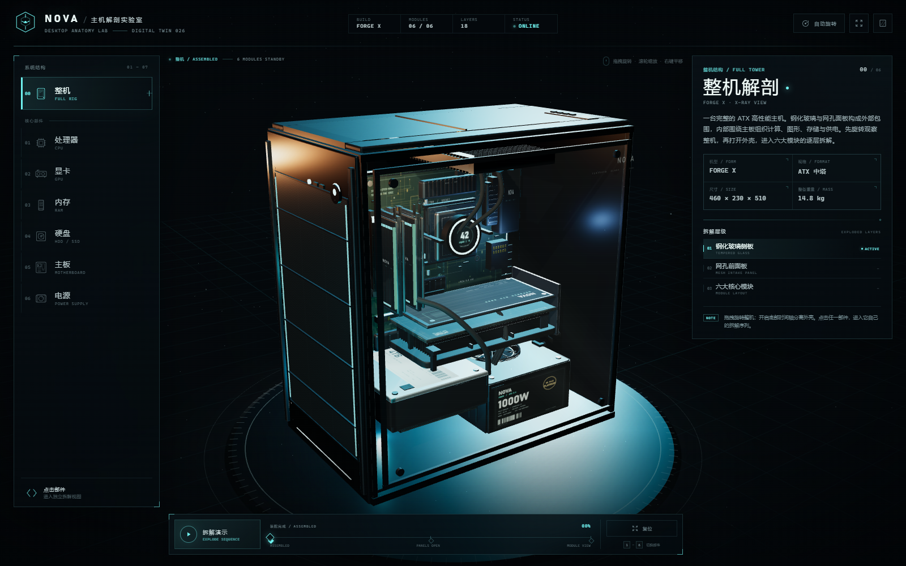

# NOVA / 电脑主机 3D 解剖实验室

一个可直接在浏览器中运行的 3D 电脑主机拆解演示。先用完整的机箱建立整体认知，再进入 CPU、显卡、内存、硬盘、主板、电源六个部件，分别播放内部逐层拆解动画。全程可拖拽旋转、缩放和平移。



## 运行方式

**直接双击 `index.html`** 即可（需 Chrome / Edge，并开启 WebGL）。页面不依赖网络、CDN 或外部图片，首次加载会在本地生成全部几何体与纹理，约需数秒。

也可以在当前目录启动一个本地服务器：

```powershell
python -m http.server 8080
# 打开 http://127.0.0.1:8080/
```

## 交互说明

| 操作 | 效果 |
| --- | --- |
| 鼠标左键拖拽 / 单指拖拽 | 旋转视角 |
| 滚轮 / 双指缩放 | 缩放 |
| 鼠标右键拖拽 / 双指平移 | 平移 |
| 点击左侧部件或 3D 热点 | 进入部件拆解视图 |
| 底部「拆解演示」 | 播放 / 暂停当前拆解序列 |
| 底部时间轴 | 手动控制外壳或部件拆解进度 |
| `1` – `6` | 切换六个部件 |
| `0` / `Esc` | 返回整机 |
| `空格` | 播放 / 暂停 |
| `A` | 自动旋转开关 |
| `R` | 重置视角 |
| `G` | 显示 / 隐藏侧透玻璃 |

侧板透明按钮位于右上角。进入部件视图后，右侧参数面板与 3D 标注会随拆解层级同步变化。

## 六个部件的拆解内容

- **CPU**：IHS 均热顶盖 → 硅晶片 Die → 封装基板 → 黄金触点层 → LGA 1700 插槽
- **GPU**：三风扇导风罩 → 均热板与鳍片 → PCB / GDDR7 显存 → 金属背板
- **内存**：铝合金散热马甲 → DDR5 颗粒与 PMIC → PCB / 288-pin 金手指
- **硬盘**：密封顶盖 → 三层盘片与主轴 → 磁头驱动臂 → 控制 PCB
- **主板**：I/O 护罩 → VRM 供电散热 → LGA 插槽 / 芯片组 → M.2 装甲 → 多层 PCB
- **电源**：顶盖与 135mm 风扇 → 外壳 → 变压器 / 电容 / 整流散热 → 全模组线材

## 技术与文件结构

- Three.js r160（本地 `vendor/three.min.js`，无需联网）
- 纯程序化建模：没有导入 GLTF/OBJ，也没有外部贴图
- Canvas 程序化纹理：PCB 走线、硬盘标签、电源铭牌、显卡背板、冲孔网板等
- 自建经典脚本版 `OrbitControls` / `RoundedBoxGeometry` 适配，因此可以直接 `file://` 打开
- 动画、相机缓动、热点投影、层级面板均为原生 JavaScript 实现

```text
index.html              页面结构 / HUD
css/style.css           视觉系统与响应式布局
js/main.js              场景、交互、相机、拆解动画
js/models.js            机箱与六大部件的程序化几何
js/textures.js          Canvas 程序化纹理
js/orbit-controls.js    轨道控制器
js/rounded-box.js       圆角盒几何
vendor/three.min.js     Three.js r160
favicon.svg             站点图标
preview.png             整机预览图
preview-detail.png      显卡拆解预览图
```

## 说明

- 产品名、型号与规格（FORGE X / CORE X9 / RTX 5080 / Z990 等）为虚构演示数据，用于展示数字孪生的信息架构。
- 机械硬盘内部为密封结构，真实设备不可在普通环境中开盖；此处的盘片与磁头拆解仅作为可视化教学演示。
- 建议使用独立显卡或开启浏览器硬件加速的 Chrome / Edge 获得最佳帧率。
- 本项目内嵌 Three.js r160（MIT License，许可见 `vendor/THREE-LICENSE.txt`）。
